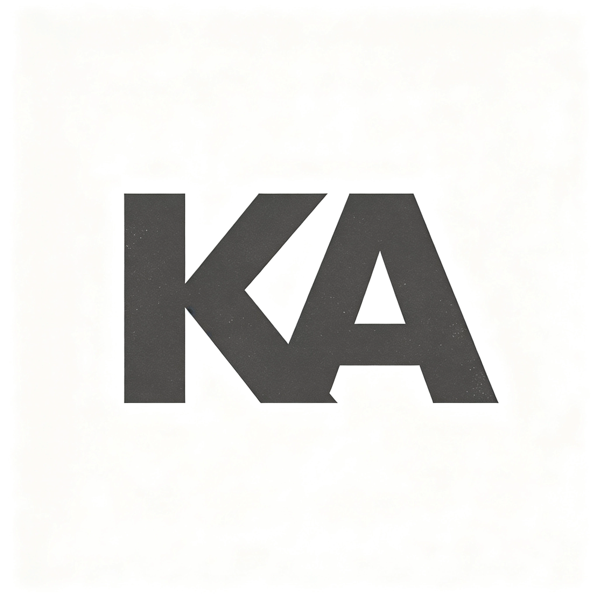

# KA Harness



> AI Agent engineering framework — Model + Harness = Agent

KA Harness 负责模型之外的一切工程化支撑：接入层、编排循环、工具系统、权限网关、可观测性。

## 状态

**Phase 1 · M3 已完成**

- [x] M1 CLI 接入层：`--version` / `--help` / `run`
- [x] 分层输出：控制层 → stderr，内容层 → stdout
- [x] 统一错误模板：发生了什么 / 影响 / 下一步
- [x] 符号白名单：✓ ⚠ ✗ ✦ ▸
- [x] 三平台交叉编译：darwin / windows / linux × amd64 / arm64
- [x] M2 编排循环：ReAct 单轮，模型只提议 tool_call
- [x] M3 工具接口：envelope v0.1 + read_file / list_dir + 路径白名单
- [ ] M4 权限网关（四态审批）

## 快速开始

```bash
# 编译
go build -o ka-harness ./cmd/harness

# 查看版本
./ka-harness --version

# 查看帮助
./ka-harness --help

# 运行任务
./ka-harness run "读取 README"
```

## 设计原则

所有面向用户的界面与交互遵循 [Apple Human Interface Guidelines](https://developer.apple.com/cn/design/)：

- **目标感**：用户随时知道 Agent 在做什么、还要做什么
- **能动性**：用户可随时暂停、回滚或接管
- **简洁**：默认折叠细节，按需展开
- **一致性**：跨平台行为连续适配

## 性能

冷启动端到端 wall time：

| 指标 | 实测（Linux 容器） | 阈值 |
|---|---|---|
| P50 | ~2.7 ms | < 300 ms |
| P95 | ~3.0 ms | < 300 ms |

Go 单二进制，零运行时依赖。

## 开发检查

```bash
bash scripts/bench_startup.sh   # 冷启动 P50/P95
python3 scripts/check_emoji.py  # 符号白名单检查
go test ./...                   # 单元测试
```

## 架构

```
cmd/harness/main.go              # 入口
internal/cli/                    # 接入层（命令解析与分发）
internal/events/                 # 分层输出 + 统一错误模板
internal/model/                  # LLM 模型抽象（当前 stub）
internal/orchestrator/           # ReAct 编排循环
internal/tools/                  # 工具注册表 + envelope + 路径白名单
internal/platform/signal/        # 信号回调签名（跨平台封装）
```

## 许可

[MIT](./LICENSE)
